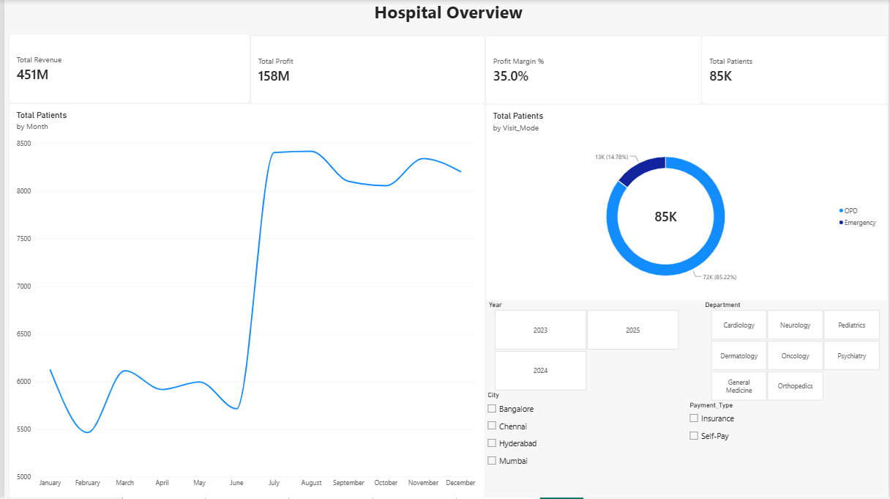
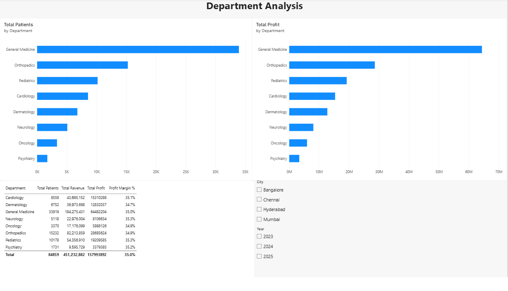
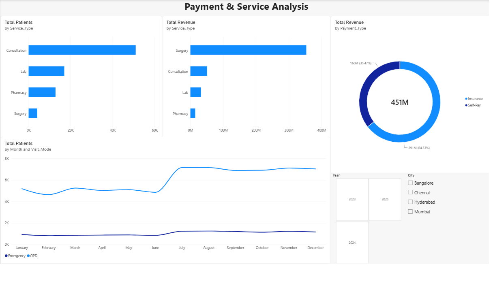
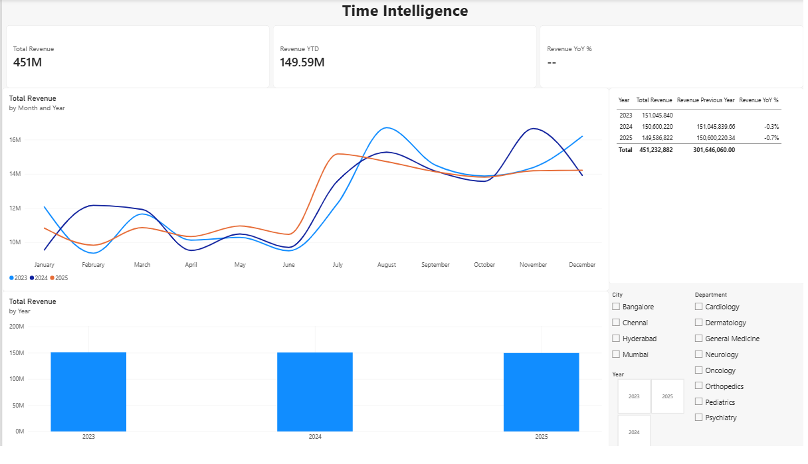
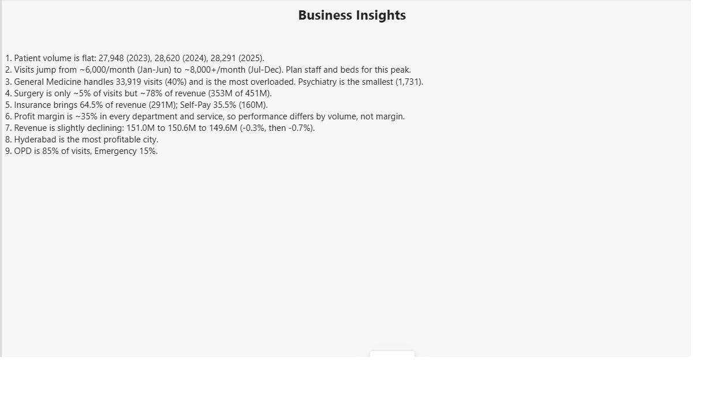

MediTrack: Hospital Operations Analytics Dashboard

Power BI project on 84,859 hospital visits (2023-2025), built on a star schema with DAX measures and time intelligence.

Tools: Power BI, Power Query, DAX

Dashboard Output

